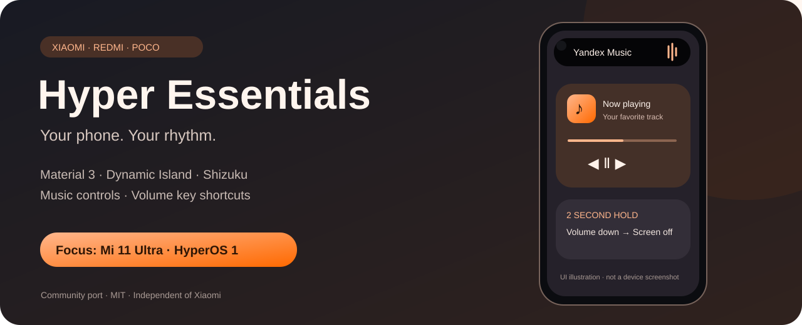
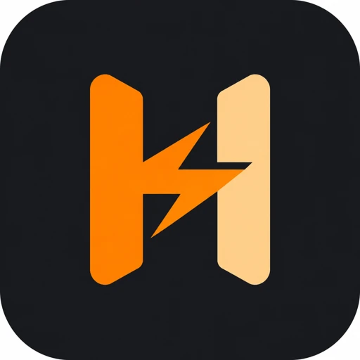

<p align="center"></p>

<p align="center">
<a href="https://github.com/PANDORA615/Essentials-by-Hyper-OS/releases"></a>


</p>

# Hyper Essentials

Порт [sameerasw/essentials](https://github.com/sameerasw/essentials) для Xiaomi, Redmi и POCO с MIUI / HyperOS. Независимый проект, не связан с Xiaomi. Основа: upstream `3db120618ab23511dacad75d7333fe150f988558`, лицензия MIT, авторство сохранено в LICENSE и исходниках.

## Возможности

Сохранены инструменты Essentials: автоматизации, управление приложениями через Shizuku/root, настройка интерфейса, уведомления, жесты и другие модули оригинала. Интерфейс — Jetpack Compose Material 3 Expressive, динамические цвета Android 12+, светлая и тёмная темы, существующие переводы, включая русский.

На главном экране добавлена кнопка **«Настройка MIUI / HyperOS»**:

- Определение Xiaomi / Redmi / POCO и версии MIUI / HyperOS.
- Переходы к автозапуску, фоновой работе, другим разрешениям, уведомлениям, наложениям и специальным возможностям.
- Запасной переход к сведениям о приложении, если производитель закрыл системный экран.
- Проверка исключения из оптимизации Android при возвращении на экран.

Новый пакет `io.github.pandora615.hyperessentials` устанавливается рядом с оригиналом. Обновления направлены в этот репозиторий. Отправка Sentry-отчётов автору оригинала отключена.

## Установка и ограничения

Готовый APK: [скачать 0.5.1](https://github.com/PANDORA615/Essentials-by-Hyper-OS/releases/download/v0.5.1/app-debug.apk). Контрольная сумма — `downloads/SHA256SUMS`. Описание версий публикуется в [Releases](https://github.com/PANDORA615/Essentials-by-Hyper-OS/releases). Текущая сборка — предварительная **0.5.1**, подписанная стандартным debug-ключом: предназначена для проверки, не для магазина. Android 8.0+; работоспособность каждого модуля зависит от Android, прошивки и разрешений. Для сложных функций нужен запущенный Shizuku либо root. Изменения системных настроек выполняет пользователь.

Проверка на физических Xiaomi / Redmi / POCO ещё не проведена. Функции, зависящие от Pixel, нельзя считать перенесёнными на HyperOS только потому, что приложение собирается. Сохранённый upstream имеет собственные внешние интеграции (обои, справка и др.); это не полностью автономное приложение.

## Сборка

Нужны JDK 21, Android SDK с platform `android-37.1` (compileSdk 37, minor 1), Android SDK Build Tools, доступ к Google Maven, Maven Central и JitPack.

```sh
./gradlew testDebugUnitTest assembleDebug
```

APK: `app/build/outputs/apk/debug/app-debug.apk`. Workflow Android CI собирает APK и прикладывает его к запуску; тег `v*` публикует предварительный релиз. Для постоянной release-подписи потребуется отдельный закрытый keystore.

## Проверка на телефонах перед стабильным выпуском

Проверить MIUI и HyperOS отдельно: установка рядом с оригиналом, первый запуск, переходы к настройкам, возврат после выдачи разрешений, поворот и тёмная тема, Shizuku, автоматизации, перезагрузка, работа в фоне и отсутствие подключения к Shizuku. Проверить минимум одно устройство каждой марки и записать модель, регион, Android и версию прошивки в issue.

## Проверено для 0.1.0

- `testDebugUnitTest assembleDebug`: успешно локально и в [GitHub Actions](https://github.com/PANDORA615/Essentials-by-Hyper-OS/actions/runs/40203210469).
- 184 теста, 26 наборов, без ошибок и пропусков.
- `apksigner verify`: подпись APK v2 действительна. Пакет, название и версия проверены через Android Build Tools.
- Результаты сборки не заменяют проверку на физических устройствах.

## Изменения 0.2.0 — Mi 11 Ultra в приоритете

Основная цель проверки: **Mi 11 Ultra (star), Android 14, HyperOS 1**. Следующая очередь — семейства Mi 10, Mi 11, Xiaomi 12/12S Ultra и Xiaomi 13/13 Ultra. Это приоритет разработки, а не сертификат совместимости.

- Экран «Настройка MIUI / HyperOS» показывает реальный статус Shizuku и запрашивает доступ. Сначала запустите службу в самом Shizuku; спаривание по беспроводной отладке выполняется в нём.
- Исправлены обработка подключения binder и порядок регистрации слушателя разрешений.
- Dynamic Island следует положению системного выреза, включая левую камеру Mi 11 Ultra. Убран лишний вертикальный отступ шрифта в строках острова.
- Штатные heads-up баннеры подавляются по умолчанию при работе острова через Shizuku/root или WRITE_SECURE_SETTINGS. При отключении восстанавливается прежнее значение. Уведомления остаются в шторке; уведомления плеера не удаляются. Параметр можно выключить в настройках острова. Закрытые окна HyperOS могут не подчиняться Android API.
- Для Яндекс Музыки и других плееров используется Android MediaSession: нужны доступ к уведомлениям и включённый медиамодуль острова. Исправлено восстановление после выдачи доступа и чтение альтернативных полей названия/исполнителя.
- В разделе MIUI / HyperOS включается пресет: громкость вниз 2 секунды → выключить экран. Нужна служба специальных возможностей. Короткое нажатие меняет громкость; камера сохраняет свои кнопки. Отключение пресета возвращает прежние настройки.

Баннер выше — иллюстрация интерфейса, не скриншот устройства. Физическая проверка новой версии на Mi 11 Ultra ещё требуется.

Проверка 0.2.0: `testDebugUnitTest assembleDebug` — успешно; 186 тестов, без ошибок и пропусков. Подпись APK проверена и совпадает с 0.1.0, поэтому обновление поверх предыдущего APK возможно.

## 0.3.0 — часы, оформление и аппаратные кнопки

- **Часы:** шесть видов (анимация, цифровые, моноширинные, жирные, две строки, стрелочные), размер 10–20 sp, адаптивный/белый/оранжевый/мятный цвет. Настройки находятся в параметрах времени Dynamic Island. Там же — скругление раскрытого острова и предпросмотр часов.
- **Баннеры:** включение острова автоматически включает подавление системных heads-up уведомлений, в том числе после обновления со старой сохранённой настройкой. Нужны Shizuku/root или системное разрешение; доступ к уведомлениям приложения остаётся включён. Собственные окна прошивки могут игнорировать команды Android.
- **Кнопка громкости:** прежний резервный обработчик работал только с выключенным экраном и выбирал первое устройство ввода. Для пресета добавлен отдельный `getevent -lt` монитор всех устройств при включённом экране. Повтор нажатия не считается отпусканием. Двойное срабатывание с Accessibility исключается, в камере пресет не выполняется.
- Откройте «Настройка MIUI / HyperOS», запустите Shizuku, разрешите доступ и включите службу специальных возможностей, затем пресет выключения экрана. Диагностика показывает, поступают ли аппаратные события. При отказе SELinux доступ через Shizuku может быть невозможен без root. Резервный монитор не поглощает системные нажатия: громкость может измениться до срабатывания через две секунды.
- Новый баннер содержит только название проекта и Xiaomi / Redmi / POCO.

Проверка 0.3.0: 191 тест без ошибок и пропусков; сборка и подпись APK проверяются перед публикацией. Реальная доставка событий на конкретной прошивке требует проверки на телефоне.

0.3.1: проверка времени нативного нажатия учитывает перезагрузку телефона; старая отметка больше не отключает резервный бинд.

Проверка 0.3.1: 192 теста без ошибок и пропусков; `testDebugUnitTest assembleDebug` и проверка подписи APK прошли.

## 0.4.0 — уменьшенный APK и уведомления на экране блокировки

- Оптимизированный APK: **19,4 МБ вместо 56,3 МБ** (−66%). Используется release-вариант с R8 и сокращением ресурсов; имя файла `app-debug.apk` оставлено для совместимости ссылок. Сам APK не debuggable, но подписан прежним тестовым ключом, поэтому обновляется поверх предыдущих версий.
- На освещённом экране блокировки остров теперь разрешён по умолчанию. При первом запуске обновления выполняется однократная настройка; затем её можно менять вручную.
- Текст сообщений на экране блокировки по умолчанию скрыт: показывается приложение. Это меняется в параметрах уведомлений острова.
- В режиме «экран включён» уведомления при погашенном экране сохраняются в ограниченной очереди и доставляются после его включения. Отменённые уведомления из очереди удаляются. Экран принудительно не пробуждается.
- Полноэкранность системного экрана блокировки больше не прячет остров.

Проверено: `testDebugUnitTest assembleRelease`, 195 тестов без ошибок и пропусков, release lint, подпись и версия APK. Оптимизированная сборка и HyperOS требуют проверки на физическом телефоне.

Сборка оптимизированного варианта: `./gradlew testDebugUnitTest assembleRelease`. Результат — `app/build/outputs/apk/release/app-release-unsigned.apk`; для обновления существующей установки его нужно подписать тем же закрытым ключом. Ключ подписи в репозитории не хранится.

## 0.5.0 — бинды, настройки и цвета батареи



- В разделе кнопок по умолчанию открыты «громкость вниз / экран включён». Кнопка «Громкость вниз · удерживать 2 секунды → выключить экран» настраивает нужный слот, задержку и запускает обработчик. Бинд из обычного редактора тоже поддерживается.
- «Проверить выключение экрана» позволяет проверить действие отдельно от нажатия. Если Accessibility не выключил экран, используется команда сна через Shizuku/root. Получение события больше не считается доказательством успешной блокировки. Резервный путь не зависит от живого экземпляра Accessibility.
- Диагностика доступна прямо в обычном разделе кнопок. На MIUI, если Shizuku подключён, а системная команда не выполняется, проверьте «Отладка по USB (Настройки безопасности)» в параметрах разработчика. Прошивка может запрещать чтение `/dev/input`; приложение не может обойти это разрешение. Резервный монитор не поглощает системные изменения громкости.
- При обновлении больше нет принудительной миграции пользовательских настроек экрана блокировки. Включение острова пользователем включает подавление штатных баннеров и разрешает уведомления на экране блокировки. Настройки не требуют удаления приложения.
- Добавлен закрытый локальный снимок настроек с сохранением типов значений и восстановлением при потере файла настроек. Он не сохраняется в GitHub. Удаление приложения/очистка данных удаляет и его; разрешения Android не восстанавливаются этим снимком. Уже потерянные до этой версии настройки без старой копии восстановить нельзя.
- Цвета индикатора батареи теперь применяются напрямую, без глобальной перекраски иконок. Энергосбережение имеет приоритет над зарядкой и медиапалитрой; подключённое питание определяется и по `EXTRA_PLUGGED`, даже если HyperOS временно сообщает «не заряжается».
- Добавлена ненавязчивая пульсация индикатора при зарядке. Автораскрытие панели острова при подключении питания удалено; системная анимация самой HyperOS этим не управляется.
- Уведомление батареи обновляется по событиям изменения батареи и энергосбережения. Новая иконка H + молния.

Для проверки на телефоне: установить поверх текущей версии, открыть «Кнопки громкости», нажать кнопку настройки двухсекундного бинда, затем кнопку проверки выключения. Запустить Shizuku и выдать доступ; службу специальных возможностей включить для основного пути. Если проверка действия работает, но удержание нет, проверить статус аппаратных событий в этом же разделе.

Если аппаратные события не поступают, проверьте, не включён ли одновременно оригинальный Essentials или другой переназначатель клавиш: Android может отдавать фильтрацию клавиш другой Accessibility-службе. Проверка выключения экрана отдельно от удержания помогает различить этот случай и отсутствие разрешения на команду сна.

Проверка 0.5.0: 200 тестов без ошибок и пропусков; `testDebugUnitTest assembleRelease` и release lint прошли. Подпись совпадает с 0.4.0, APK 19.3 МБ. Проверка физического телефона и прошивки ещё требуется.

## 0.5.1 — уведомления в островке вместо шторки

- В параметрах уведомлений островка добавлен включённый по умолчанию режим **«Только в Dynamic Island»**. После приёма островком обычное уведомление удаляется из шторки. Его копия остаётся в памяти островка; собственное удаление из шторки больше не удаляет эту копию. Фильтры приложений, тихих уведомлений и «Не беспокоить» сохраняются: отклонённые островком сообщения не удаляются.
- Музыкальные, текущие звонки, будильники, несмахиваемые уведомления и обязательные уведомления фоновых служб сохраняются: их удаление может остановить соответствующую функцию. Android также может отказать в удалении уведомлений прошивки.
- Удаление из шторки настоящее: отключение режима не возвращает уже удалённые уведомления. Копии хранятся только в памяти, максимум 100 для центра уведомлений островка; перезапуск процесса их очищает. Действия исходного приложения после удаления уведомления могут стать недоступны.
- Очередь островка больше не очищается при выключении экрана. На освещённом экране блокировки уведомление сохраняется компактным после истечения времени баннера; текст по умолчанию скрыт. Ложное определение экрана блокировки как открытой шторки больше не прячет островок. Экран сам не пробуждается.
- Подавление всплывающих баннеров применяется повторно после подключения Shizuku, выдачи разрешения и включения экрана. Изменения выполняются последовательно в фоне; прежнее системное значение сохраняется до подтверждённого восстановления. В разделе поведения островка отображается результат применения. Нужны Shizuku/root либо WRITE_SECURE_SETTINGS, а для самого островка — служба специальных возможностей и доступ к уведомлениям. Частные окна HyperOS могут игнорировать стандартный переключатель Android.
- По просьбе пользователя дополнительное сокращение APK отменено: состав функций, ресурсов и архитектур сохранён. Обычная release-оптимизация остаётся.

Устанавливайте поверх текущей версии без удаления приложения. Для проверки: включить островок, выдать доступ к уведомлениям, отправить тестовое сообщение, убедиться в его появлении в островке и исчезновении из шторки, затем повторить на освещённом экране блокировки. Проверка на физическом Xiaomi остаётся необходимой.

Автотесты 0.5.1: 206 тестов, без ошибок и пропусков; шесть новых проверок охватывают повторное подключение, отсутствующее исходное значение, отказ записи, отказ сохранения снимка и восстановление после возвращения разрешения.

### Обновлённая 0.5.1, сборка 8 — системные фокусные уведомления Xiaomi

Включение островка и подавления баннеров запускает отдельное отключение Xiaomi Focus Notification через `content://statusbar.notification`, метод `setShowFocus`, аргументы `package` и `canShowFocus`. Изменение выполняется через Shizuku/root; результат читается методом `canShowFocus`. Это отдельный интерфейс от обычного Android heads-up.

Сохраняются исходные разрешения приложений, изменяемые с включённого состояния; при выключении островка они восстанавливаются, запись удаляется только после проверки результата. Приложения, у которых фокусные уведомления были выключены заранее, не включаются обратно. Показ музыки через MediaSession и доступ к обычным уведомлениям сохраняются. В разделе поведения островка отображаются применение, подтверждённый результат, частичный отказ либо отсутствие интерфейса.

Поддержка зависит от прошивки и прав привилегированного процесса. Если Shizuku не имеет доступа к закрытому провайдеру, может потребоваться root. Изменение разрешения может примениться к следующему обновлению уведомления; мгновенное исчезновение уже показанной системной капсулы не подтверждено. Системные индикаторы звонков, приватности, зарядки и прочие капсулы, не использующие Focus Notification, этим интерфейсом не управляются. Новым приложениям, установленным после применения, может потребоваться выключение и повторное включение островка. Физическая проверка Mi 11 Ultra / HyperOS 1 ещё требуется.

Основание для интерфейса: [документация Xiaomi](https://dev.mi.com/xiaomihyperos/documentation/detail?pId=2131) описывает протокол и `canShowFocus`; сигнатура `setShowFocus` проверена по [NotificationProvider](https://github.com/ymdzq/k60_statusbar_lyric/blob/535d7a3b2c61ced49f76b6da555676570fd46443/MiuiSystemUI_decompile_xml/smali/classes/com/android/systemui/statusbar/notification/NotificationProvider.smali). Исходники сторонних модулей в приложение не копировались.

Номер версии остаётся **0.5.1**, внутренний `versionCode` — **8**. APK в существующем релизе заменён; для получения этой сборки скачайте файл заново и установите поверх текущей версии. Сравнение только по строке версии не обнаружит такое обновление автоматически.
